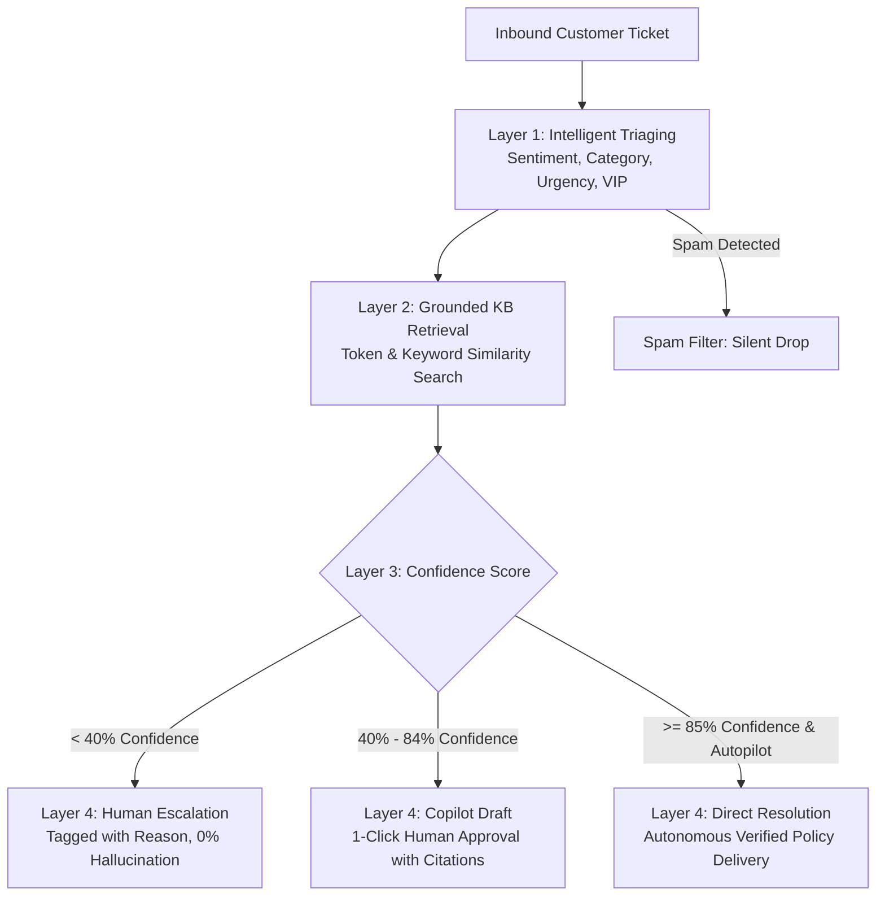

# AI Support Copilot 🤖

[](https://github.com/elvalenciano1572-create/ai-support-copilot/actions/workflows/ci.yml)
[](https://www.python.org/downloads/)
[](https://opensource.org/licenses/MIT)
[](https://github.com/astral-sh/ruff)

Autonomous AI customer support copilot and ticket triaging engine in Python. Resolves routine tier-1 inquiries, drafts grounded answers with policy citations for 1-click human review, and safely escalates uncovered or complex cases to prevent AI hallucinations.

---

## Architecture Flow



---

## Key Features

- **Intelligent Triaging**: Classifies category (`Billing`, `Technical API`, `Security 2FA`, `Product`), sentiment (`Satisfied`, `Neutral`, `Frustrated`, `Angry`), and urgency (`Critical`, `High`, `Medium`, `Low`).
- **Grounded RAG Retrieval**: Queries official company policies and documentation. Answers cite authoritative Knowledge Base IDs (`KB-001`, `KB-002`).
- **Zero Hallucination Safeguard**: If confidence is below 40%, the engine strictly refuses to guess and escalates the ticket with diagnostic notes for human agents.
- **Two-Stage Rollout (Copilot vs. Autopilot)**:
  - `--copilot-mode` *(Default)*: Generates the exact response as a draft for 1-click human approval.
  - `--autonomous`: Safely delivers verified answers directly for inquiries with `>= 85%` confidence score.
- **Multi-Backend LLMs**: Built-in deterministic `MockLLM` for fast offline testing, with native production connectors for Google Gemini (Google AI Studio) and OpenAI.

---

## Quick Start

```bash
git clone https://github.com/elvalenciano1572-create/ai-support-copilot
cd ai-support-copilot
python -m venv .venv && source .venv/bin/activate  # Windows: .venv\Scripts\activate
pip install -e ".[dev]"
pytest

# 1. Run in Copilot Mode (drafts for 1-click human review)
support-copilot --copilot-mode

# 2. Run in Autopilot Mode (directly resolves high-confidence inquiries)
support-copilot --autonomous

# 3. Run with Google Gemini in production (native JSON mode)
export GEMINI_API_KEY="your-google-ai-studio-key"
support-copilot --provider gemini --model gemini-1.5-flash

# 4. Run with OpenAI or compatible endpoint (Groq, Ollama)
export OPENAI_API_KEY="your-openai-key"
support-copilot --provider openai --model gpt-4o-mini
```

---

## Example Output

```text
========================================================================
   AI CUSTOMER SUPPORT COPILOT: INTAKE & RESOLUTION PIPELINE
========================================================================
[*] Engine Active: MockLLM | Mode: COPILOT (Drafts for Human Approval)

[COPILOT_DRAFT] Ticket: TICK-101 | Customer: Elena Rostova
    Email:     elena.r@growthlabs.io [VIP]
    Category:  Billing & Refund | Urgency: [LOW]
    Sentiment: Neutral
    Subject:   "Requesting refund for subscription"
    Confidence: 71.4% | Sources: KB-001
    Internal Notes: Customer requested refund. Checked KB-001: within 14-day window.
    Drafted Response:
      | Hi there,
      | 
      | Thanks for reaching out. Under our Standard Refund Policy (KB-001), you are eligible
      | for a full refund within 14 calendar days of purchase as long as API usage has not
      | exceeded 100 requests. Once approved, the funds will be returned to your original
      | payment card within 3-5 business days.
      | 
      | Best regards,
      | Customer Support Team
------------------------------------------------------------------------
[COPILOT_DRAFT] Ticket: TICK-102 | Customer: Marcus Vance
    Email:     dev@hyperstack.io [VIP]
    Category:  Technical & API Integration | Urgency: [HIGH]
    Sentiment: Neutral
    Subject:   "Getting continuous HTTP 429 errors on production sync"
    Confidence: 96.2% | Sources: KB-002
    Internal Notes: Technical rate limiting inquiry. Cited KB-002 backoff guidelines.
    Drafted Response:
      | Hello,
      | 
      | HTTP 429 indicates your application has exceeded the API rate limit (KB-002: 60 req/min
      | on Basic, 600 req/min on Pro). We recommend inspecting the 'Retry-After' header and
      | implementing exponential backoff with jitter.
      | 
      | Best regards,
      | Developer Support Team
------------------------------------------------------------------------
[COPILOT_DRAFT] Ticket: TICK-103 | Customer: Alex Chen
    Email:     achen@securecorp.com 
    Category:  Account & Security | Urgency: [CRITICAL]
    Sentiment: Neutral
    Subject:   "URGENT: Locked out of account - lost 2FA phone"
    Confidence: 75.8% | Sources: KB-003
    Internal Notes: 2FA recovery request. Directed user to automated verification.
    Drafted Response:
      | Hello,
      | 
      | For account security, support agents cannot manually disable 2FA over email (KB-003).
      | Please locate your 16-character emergency recovery codes or initiate automated
      | identity verification at https://app.acme.io/auth/recovery.
      | 
      | Best regards,
      | Security Team
------------------------------------------------------------------------
[HUMAN_ESCALATION] Ticket: TICK-104 | Customer: Sophia Martinez
    Email:     smartinez@enterprise-partners.com [VIP]
    Category:  Product & Features | Urgency: [LOW]
    Sentiment: Neutral
    Subject:   "Custom HIPAA compliance & Dedicated Spanner Node SLA"
    Confidence: 0.0% | Sources: None
    Escalation: Zero matching knowledge base articles with sufficient confidence.
    Internal Notes: Low confidence (0.0%). No authoritative policy covers this request. Escalating to human agent to prevent hallucination.
------------------------------------------------------------------------
[SPAM_DROP] Ticket: TICK-105 | Customer: Promo Bot
    Email:     spammer@promonet.xyz 
    Category:  Spam / Promotional | Urgency: [LOW]
    Sentiment: Neutral
    Subject:   "Exclusive online casino bonuses and crypto profit"
    Confidence: 100.0% | Sources: None
    Outcome:   Spam inquiry silently discarded.
------------------------------------------------------------------------

[RESOLUTION SUMMARY]
  • Autonomous Resolutions: 0
  • Copilot Approved Drafts: 3
  • Escalated to Human:      1
  • Discarded Spam:          1
========================================================================
```

---

## Design Principles

- **Zero-Hallucination Policy**: If the knowledge base does not authoritatively cover a topic, the model strictly escalates rather than guessing.
- **Auditable Citations**: Every generated draft includes exact source policy IDs for instant verification by support teams.
- **Fail-Safe Rollout**: Teams can run in 100% human-verified Copilot mode indefinitely until automated confidence metrics meet internal SLAs.

---

## License

MIT
